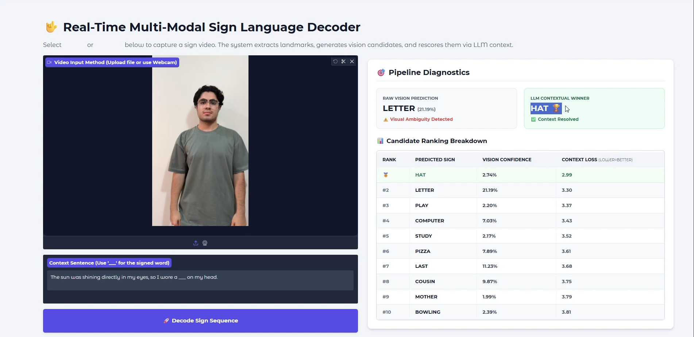
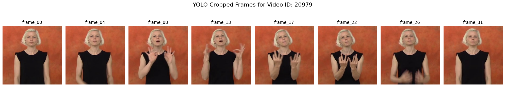
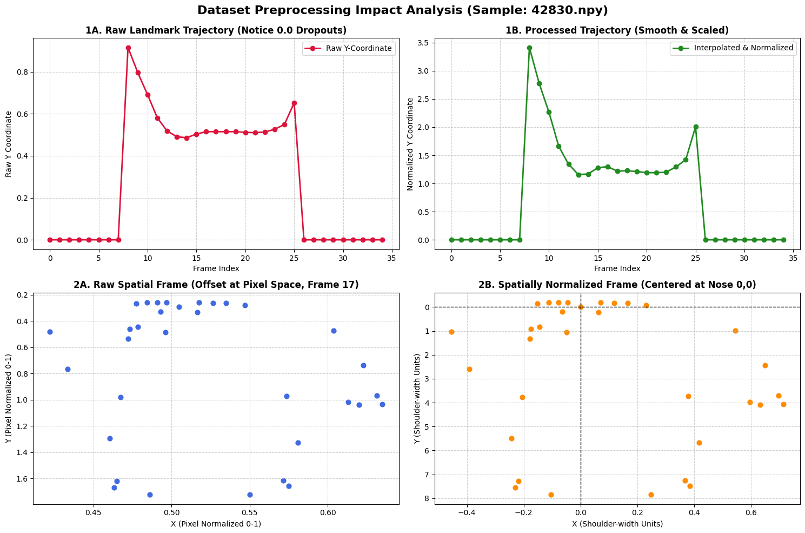

# WLASL Sign Language Recognition

**Video and skeletal-sequence modeling for isolated American Sign Language recognition.**

A collaborative course project at **K. N. Toosi University of Technology** exploring two representations of signing motion: RGB video processed with a Video Swin Transformer, and MediaPipe landmarks processed with temporal convolution and bidirectional LSTM models. The repository also includes a Gradio demonstration that reranks visual predictions using sentence context.

**Team:** Mobina Yousefi Moghadam · Iman Bidi · Yazdan Bayat  
**Project materials:** [Technical report](reports/project-report.pdf) · [Presentation](reports/presentation.pdf) · [Demo recording](assets/demo.mkv)



*Screenshot preserved from the project's report source. The example shows a visual prediction and a context-based reranking; it is a demonstration, not a quantitative evaluation of the combined system.*

## Project focus

Recognizing an isolated sign requires modeling hand motion and body pose over time. RGB models retain appearance information but also process background pixels. Landmark sequences offer a compact representation, while depending on reliable keypoint extraction and preprocessing.

This project investigates that tradeoff through:

- **RGB modeling:** YOLO-based person crops, fixed-length frame sampling, and pretrained Swin3D-T fine-tuning.
- **Landmark modeling:** pose and hand extraction, missing-hand interpolation, spatial normalization, and temporal velocity features.
- **Sequence experiments:** ConvBiLSTM variants and a graph-based pose baseline in the original notebooks.
- **Contextual demonstration:** a 100-class visual classifier followed by GPT-2 sentence-loss ranking of its top candidates.

The task is **isolated word recognition**. The application uses a user-supplied sentence with a blank; it does not implement continuous sign segmentation or full sign-language translation.

## Two experiment paths

| Path | Representation | Main entry point | Split procedure |
|---|---|---|---|
| RGB / Video Swin | 32 sampled RGB frames, resized to 224 × 224 | `train.py` and `src/` | Uses `split` labels from the supplied WLASL metadata for videos with extracted folders |
| Landmark / ConvBiLSTM | 258 pose/hand features; 516 after adding velocities | `notebooks/landmark_pipeline.ipynb` | Custom approximately 80/10/10 grouping by base video ID, seed 42 |

The landmark notebook selects 100 glosses by metadata instance count. Its custom split is distinct from the official WLASL benchmark split and does not establish signer-independent evaluation.



*Existing project figure illustrating the RGB preprocessing route. The landmark demo extracts MediaPipe features directly from the submitted video.*

## Results with their evaluation context

| Experiment | Evaluation context | Top-1 | Top-5 | Evidence |
|---|---|---:|---:|---|
| RobustConvBiLSTM | Custom 100-class **validation** split; first epoch attaining the best recorded Top-1, epoch 63 | **43.56%** | **68.32%** | Saved output in `landmark_pipeline.ipynb`, code cell 18 (zero-based) |
| Swin3D-T | **Test result reported in the project report** for the 2,000-class RGB experiment | 23.94% | 59.81% | Original technical report; standalone run logs are not included |

The landmark run also reaches **72.28% validation Top-5 at epoch 61**, where Top-1 is **35.64%**. That is a separate validation peak, not the Top-5 score paired with the selected best-Top-1 epoch. No held-out test result for this RobustConvBiLSTM run is saved in the notebook.

These rows describe different class sets and split procedures. They do not establish a direct accuracy improvement between the models. See [results and provenance](docs/results.md) for the precise interpretation and [the recorded validation history](results/robust-convbilstm-validation.csv).

## Run the local demonstration

Use Python 3.10 or 3.11 and create a virtual environment. From the repository root:

```bash
python -m venv .venv
```

Activate it on Linux/macOS with `source .venv/bin/activate`, or on Windows PowerShell with `.venv\Scripts\Activate.ps1`. Then:

```bash
python -m pip install --upgrade pip
python -m pip install -r requirements-demo.txt
cd demo
python app.py
```

Open the local URL printed by Gradio. Upload a short sign video or record one using the browser's webcam option. Enter a sentence containing `___`, then select **Decode Sign Sequence**.

For example:

```text
The sun was shining directly in my eyes, so I wore a ___ on my head.
```

The included `demo/best_convbilstm_model.pth` and `demo/class_mapping_100.json` are the original project artifacts. On first launch, the application downloads MediaPipe task models and GPT-2 assets, so network access is required. Run from `demo/` because the original extraction module stores its task models relative to the working directory.

[Demo setup and behavior](demo/README.md) describes dependencies, candidate ranking, and troubleshooting. The dependency file targets the original Gradio 5 API; it is not a lockfile for the historical training environment.

## Reproduce the RGB experiment

Obtain WLASL videos and `WLASL_v0.3.json` separately. Install the training dependencies, edit the paths in `configs/base.yaml`, extract frames, then train:

```bash
python -m pip install -r requirements.txt
python scripts/extract_yolo.py
python train.py --config configs/base.yaml
```

The extraction script uses `./videos` and `./extracted_frames_yolo` by default. Editing a training YAML does not change those extraction defaults. Match those paths or call its function with explicit paths, as shown in [the reproduction guide](docs/reproduction.md).

The RGB training entry point supports differential learning rates (`paper_end2end`) and progressive unfreezing (`progressive`). It builds the Swin model, not the landmark model. Use an NVIDIA CUDA environment for this training route; its original training loops use CUDA AMP. Choose the PyTorch build appropriate to your machine using the [official installation selector](https://pytorch.org/get-started/locally/).

## Reproduce the landmark experiments

Open [the main landmark notebook](notebooks/landmark_pipeline.ipynb) in Google Colab. The notebook contains dataset extraction, MediaPipe processing, a base ConvBiLSTM experiment, a pose-graph experiment, and the RobustConvBiLSTM run.

Its original path settings expect a dataset ZIP at `/content/drive/MyDrive/SignLanguageProject/wlasl-processed.zip`. Update the path variables for your own files. The notebook retains its historical outputs and empty cells; it is an experiment record rather than a packaged command-line pipeline. Earlier preparation and sequence notebooks are preserved in [the notebook archive](notebooks/archive/).

## Repository organization

| Location | Contents |
|---|---|
| `src/` | RGB data loading, Swin construction, training, evaluation, and logging |
| `train.py` | RGB experiment entry point |
| `scripts/` | YOLO frame extraction and small synthetic-data generator |
| `configs/` | Local, laptop, Kaggle, and synthetic-data YAML settings |
| `notebooks/` | Main landmark notebook and earlier experiment records |
| `demo/` | Gradio app, landmark processing, visual checkpoint, class mapping, and GPT-2 reranking |
| `assets/` | Original project screenshots, figures, and recording |
| `reports/` | Original report, presentation, and extracted LaTeX sources |
| `results/` | Validation metrics extracted from saved notebook output |
| `docs/` | Reproduction guidance, results provenance, and maintenance notes |



*Figure extracted from a saved output in the original data-preparation notebook. It illustrates a preprocessing example; it does not quantify recognition accuracy.*

## Data and attribution

The dataset is **WLASL (Word-Level American Sign Language)** by Li et al. The project materials reference a [processed copy on Kaggle](https://www.kaggle.com/datasets/risangbaskoro/wlasl-processed). The [original WLASL repository](https://github.com/dxli94/WLASL) provides the metadata, preparation instructions, paper citation, and dataset terms.

Dataset videos and generated landmark arrays are not included here. Available video counts can differ from metadata counts; record the actual usable IDs when rerunning an experiment.

## Scope and current validation

The original report, presentation, notebooks, checkpoint, and demonstration are retained. Documentation and file organization were revised without changing the training code, application code, checkpoint bytes, or notebook cells and outputs.

The cleanup was checked for Python syntax, local links, configuration structure, asset paths, and preservation of the original artifacts. Training and the Gradio application were not executed during this cleanup. The saved outputs document the original runs; they are not new benchmark results.

## Authors and licensing

- [Yazdan Bayat](https://github.com/YzdnByat)
- [Mobina Yousefi Moghadam](https://github.com/mobinamqdm)
- Iman Bidi


The project artifacts identify these three authors. Individual responsibilities are not assigned here without confirmed contribution information.

A repository code license has not been supplied. Dataset, pretrained-model, and third-party library terms are separate from any future license chosen for the team's own code.
